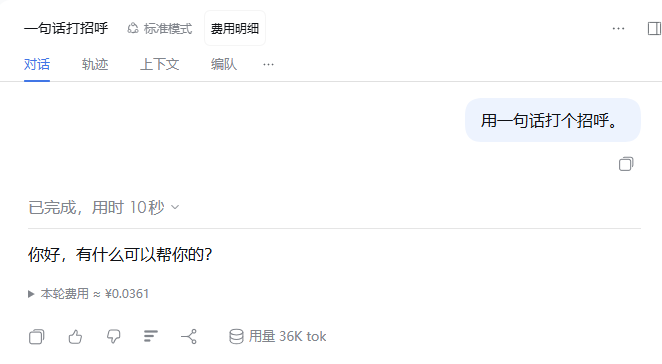
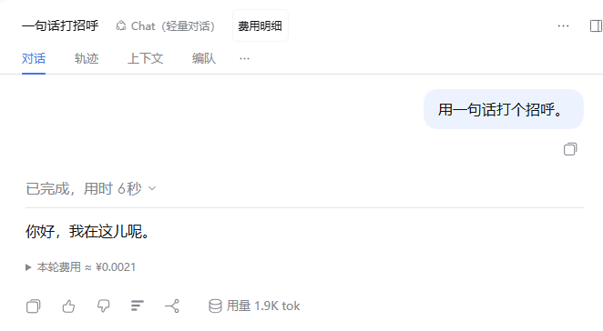

[English](README_en.md) | [简体中文](README.md)

# dsh-plugin-chat-mode

[](https://github.com/XiaoFeng7418/dsh-plugin-chat-mode/actions/workflows/ci.yml)
[](https://github.com/XiaoFeng7418/dsh-plugin-chat-mode/releases)
[](LICENSE)

A minimal, **tool-free, low-token** `Chat` mode for [DeepSeek Harness](https://github.com/deepseek-ai/deepseek-harness) (DSH): same harness, same sessions and UI — just without what an everyday conversation does not need.

**Standard mode (36K tokens / ¥0.0361)**



**Chat mode (1.9K tokens / ¥0.0021)**



| | Standard | Chat (`web-tone`) | Chat (`empty`) |
| --- | --- | --- | --- |
| `tools` field | 103 schemas | **absent** | **absent** |
| `system` | 14,476 characters | 61 characters (253 for the English tone line) | **empty (field absent)** |
| thinking | on, effort `high` | off by default | off by default |
| `temperature` | not sent | **1.0** | **1.0** |
| input tokens | 35,967 | **1,880** | **1,842** |

About **19x fewer input tokens**, with no tool schemas in the request at all. Numbers come from one desktop install with several plugins loaded; absolute values vary, the ratio and the absent `tools` field do not. **No default preset is modified**: Standard, PTC, Minimal, Creative and any preset you installed stay untouched.

## Install

**Desktop app**: open **Plugins → Add plugin** and enter

```
github:XiaoFeng7418/dsh-plugin-chat-mode
```

**CLI / other DSH clients**:

```sh
dsh plugin --profile <profile> add github:XiaoFeng7418/dsh-plugin-chat-mode
```

Then start a new chat and pick **Chat (lightweight)** in the mode switcher.

<details>
<summary>Other install paths (release tarball / pinned version / local checkout)</summary>

```sh
# packaged release tarball (no source build)
dsh plugin --profile <profile> add https://github.com/XiaoFeng7418/dsh-plugin-chat-mode/releases/download/v0.2.0/dsh-plugin-chat-mode-0.2.0.tgz

# pin a release
dsh plugin --profile <profile> add github:XiaoFeng7418/dsh-plugin-chat-mode#v0.2.0

# local development (links the directory into the profile)
dsh plugin --profile <profile> add /absolute/path/to/dsh-plugin-chat-mode
```

</details>

## Slash commands

Type them in the composer. Everything runs **locally**: no tokens, no extra request, no effect on other sessions.

| Command | Effect |
| --- | --- |
| `/chat` | Show this session's tone, temperature, web switch and usage |
| `/chat savings` | Estimate input tokens saved this session against the Standard baseline |
| `/chat save` | Persist the current choice into `~/.dsh/chat-mode.json` for new sessions |
| `/tone web\|empty\|concise\|creative` | Natural chat / no system prompt / terse / brainstorm |
| `/tone custom <text>` | Use a short custom system prompt for this session |
| `/think on\|off\|low\|high\|max` | Deep thinking: `on` = `high` (the web client's level); no temperature is sent while it is on |
| `/web on\|off` | Allow the `web_search` / `web_fetch` tools (off by default) |
| `/temp auto\|off\|0-1.5` | Temperature: follow the tone default / never send / pin a value |

Switches live in memory for the current session only; a DSH restart falls back to the configured defaults — run `/chat save` to keep a choice.

## On DSH Go (Android)

1. In the web UI open **Plugins → +**, enter `github:XiaoFeng7418/dsh-plugin-chat-mode` (or a release tarball / a local directory on the phone), install, then tap "enable".
2. The native UI only offers DSH Go's own modes; tap **Switch to web interface** in the sidebar and pick **Chat (lightweight)** in the new-session mode picker.
3. For casual chat you can temporarily disable **`agent-teams`** in the plugin manager to drop its extra tools and context. Web search was verified on-device (app 1.1.0 / 1.2.0, bundled engine `0.2.2-rc.1`): `/web on` adds about **+455 input tokens** and uses `deepseek-official` server search, billed as model tokens only.

See [TECHNICAL_en](docs/TECHNICAL_en.md) for details and known differences.

## Configuration

Preset sub-rows are **read-only** in the settings UI, so tune the mode with `~/.dsh/chat-mode.json` (`$DSH_HOME/chat-mode.json`):

```json
{
  "promptMode": "web-tone",
  "temperature": 1.0,
  "defaultThinking": "off"
}
```

Priority: built-in defaults → row config in `cordis.patch.yml` → this file. Full option table, `traceFile` diagnostics and request shape live in [TECHNICAL_en](docs/TECHNICAL_en.md); changes per version are in [CHANGELOG](CHANGELOG.md).

## Development

```sh
pnpm install
pnpm run typecheck
pnpm test
```

Re-mount after changes: `dsh plugin --profile <name> add /absolute/path/to/dsh-plugin-chat-mode` (re-installing the same path in the desktop app asks for a restart; installing from a fresh directory reloads the running app).

## Credits and license

Preset/bundle conventions, `tools.restrict` and the `agent/request` hook come from [deepseek-ai/deepseek-harness](https://github.com/deepseek-ai/deepseek-harness); request-shape conventions were informed by [deepseek-ai/chat-demo](https://github.com/deepseek-ai/chat-demo). Code is [MIT](LICENSE).
